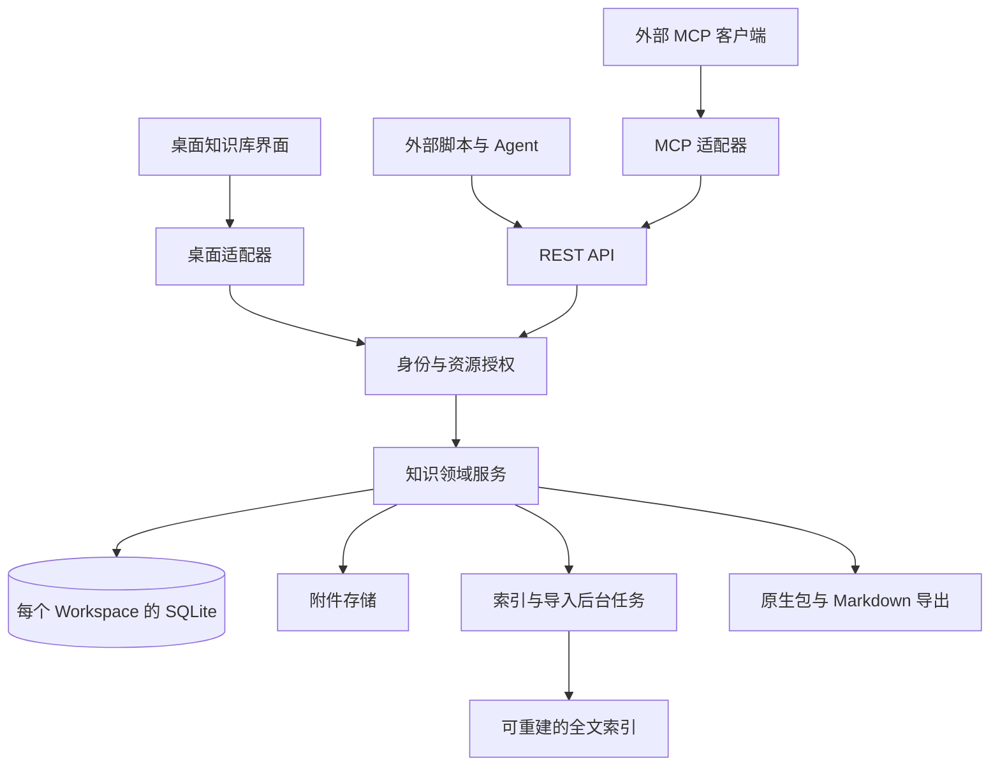

# 开源个人知识库 · 完整开发 Plan v2.0

修订日期：2026-11-13。原文件名：`个人资源管理系统_完整开发Plan.md`。

**产品定位：以类 Notion 的页面、块、数据库和知识组织为主体，提供开放接口供外部 Agent 与其他工具使用，整个自研系统开源。**

本文维护产品与开发基线。2026-11-15 的源码版本为 **0.9.0**，已推进数据库、全文检索、模板、正文图文、CSV 交换、批量整理、正文块移动和保存故障处理。实际交付与验收范围见 [开发进度](开发进度.md)。文档版本 v2.0 与软件版本独立。

## 0. 本次修订与阅读方式

### 0.1 需求依据

| 类别 | 内容 | 本文如何处理 |
|---|---|---|
| 本次用户要求 | 减轻 Agent 方向；主要功能是类 Notion 知识库；有外部接口供 Agent 使用；整个系统开源 | 作为新版的最高优先级 |
| 本次用户补充确认 | 保留本地优先、Windows 起步，后续支持自托管同步 | 作为部署与平台基线 |
| 原稿中继续保留的背景 | 个人使用优先、离线可用、可视化编辑、数据可迁移、单人主导开发、没有固定工时 | 用于安排功能与工程路线 |
| 本次设计建议 | 首版边界、存储收敛、许可证候选、具体技术与里程碑 | 明确是规划选择，不冒称用户逐项确认或已技术验证 |

原稿中的“前五阶段不得调整”“正式首版必须完成全部旧需求”“官方运营后台可闭源”等内容，是旧计划的历史安排。本次重新设计以用户的新目标为准，重新安排阶段、功能边界与开源范围。原文不是对本次文档修改工作的操作指令。

### 0.2 主要变化

| 设计项 | v1.0 原计划 | v2.0 本计划 |
|---|---|---|
| 日常主线 | 知识库、Agent 工作台、自动化、资源编辑等多条主线 | 创建、组织、查找、关联、导入导出知识 |
| Agent 的位置 | 内置 Runtime、AgentHub、Memory、模型中心、Runner | 外部程序；通过授权的 API／MCP 读写知识库 |
| 开放接口排期 | 主要在原 M12 完善 | 新 M3 交付可用接口；新 M5 纳入 1.0 验收 |
| 首版路线 | 原 M0–M16，涵盖大量独立产品 | 新 M0–M5，交付本地知识库与开放集成 |
| 后续路线 | 多端、算力、社区、IDE 等共同阻塞正式版 | 同步协作、跨端等单独演进，不阻塞本地 1.0 |
| 数据写入 | Markdown、结构库、CRDT 多份状态协调 | 首版一个领域提交入口；SQLite 保存权威结构，Markdown 为开放导出 |
| 开源范围 | 核心与自建能力开源，部分运营可闭源 | 所有自研产品组件纳入开源，包括未来服务端与管理界面 |

先读第 1–3 章了解产品；第 4–6 章对应实现架构和对外契约；第 7–10 章用于开发、验收与开源协作；第 11 章逐条说明原 84 组需求的去向。

工程入口、启动方式与源码结构见 [README](README.md)。接口和 Issue 的实际进度随各阶段记录。

## 1. 产品定义与取舍

### 1.1 用户获得的核心价值

用户可以离线写文档，用页面树组织知识，用数据库管理论文、阅读清单和项目资料，通过搜索与双向引用找到内容，并将完整数据迁移出去。需要 AI 时，用户把指定内容授权给自己选择的外部 Agent；不配置模型也能完成全部核心操作。

首要用户是管理个人知识的使用者。外部开发者和 Agent 是接口使用者。小团队协作属于后续能力，不在个人编辑界面引入任务审批、执行角色或模型配置。

“类 Notion”在本文中特指页面与块编辑、记录即页面的数据库、多视图、模板和引用等知识管理体验。API 与数据格式采用本项目公开契约，不承诺逐端点兼容 Notion，也不承诺复制其全部产品功能。Notion 的页面、数据库等资源 API 仅作为接口组织参考。[Notion API 官方说明](https://developers.notion.com/reference/intro)

### 1.2 四条优先用户流程

1. **写与整理**：新建 Workspace → 新建页面 → 使用块编辑 → 添加子页面与引用 → 自动保存 → 离线重开。
2. **结构化管理**：建立“阅读资料”数据库 → 每条记录打开完整页面 → 设置作者、状态、日期等属性 → 在表格、看板与日历之间切换。
3. **查找与迁移**：导入 Markdown／附件 → 搜索关键词 → 跳到对应页面或块 → 导出后在新 Workspace 恢复。
4. **外部辅助**：在设置中创建集成 → 选择可访问页面及写入方式 → 外部 Agent 检索与读取 → 创建草稿或提出修改 → 用户查看来源与改动。

### 1.3 比较后的路线

| 路线 | 优点 | 代价 | 处理 |
|---|---|---|---|
| 本地知识库 + 开放 API／MCP | 延续已有本地方向，离线独立可用，知识与执行解耦 | 后续同步需要独立设计；本机关闭后本地接口不可用 | **采用；本地优先已获本次确认** |
| Web 知识库 + 自托管后端 | 浏览器访问与多人共享较集中 | 首期需账号、部署和离线缓存；改变原本地使用习惯 | 保留为后续 Web 客户端方向 |
| 知识库 + 内置 Agent 平台 | 能把执行流程集中展示 | 需要运行时、模型、任务、记忆和算力多套系统 | 移出当前产品主线 |

### 1.4 范围边界

1.0 包含页面与块、六种基础数据库视图、基础关系与计算、全文搜索、引用、附件、模板、导入导出、历史回收、备份、API、MCP 和集成授权。

1.0 后优先考虑自托管同步、小团队共享、其他桌面与移动采集、Web 访问、公开页面、网页剪藏、图谱与白板。它们逐项立项，不形成下一轮“全部完成才能发布”的大包。

当前主线不开发 AgentHub、Runtime Driver、Agent Memory／Experience、模型下载与路由、GPU 调度、Runner 池、多 Agent 通信、通用工作流引擎、IDE／终端、Office 编辑和公共资产市场。代码块、文件附件、数据库任务模板仍属于知识库能力。

轻量 AI 摘要、润色或知识问答可在 1.0 后作为可关闭的扩展评估；不成为搜索、写作、数据库或启动流程的依赖。外部自动化直接调用接口，核心仅承担知识操作与必要的索引、导入等后台任务。

## 2. 信息架构与交互设计

### 2.1 主界面

```text
┌────────────────┬───────────────────────────────────┬──────────────┐
│ 工作空间 ▾     │ 面包屑                     分享／… │ 页面信息     │
│ 搜索           │                                   │ 属性         │
│ 最近           │ 图标  页面标题                     │ 反向链接     │
│ 收藏           │ 页面属性                           │ 目录         │
│ 收集箱         │                                   │ 历史         │
│                │ 正文块编辑器 / 数据库视图          │              │
│ 页面树         │                                   │ 默认收起     │
│ ▸ 学习资料     │ 输入 / 插入块，@ 引用页面          │              │
│ ▸ 阅读清单 ▦   │                                   │              │
│ + 新建         │                                   │              │
│ 回收站 · 设置  │ 已保存 / 正在保存 / 保存失败        │              │
└────────────────┴───────────────────────────────────┴──────────────┘
```

侧栏的“收集箱”是默认收集页面或数据库，沿用普通页面数据模型；不创建独立订阅与消息处理系统。“最近”“收藏”是入口，不另存正文。数据库可以出现在页面树及页面正文中；附件通过页面或附件管理入口使用。

首版提供深浅主题、键盘导航、命令面板、中文输入法支持、可折叠侧栏和专注模式。多标签、分屏、复杂自定义布局在核心体验稳定后迭代。菜单只展示已实现功能。

### 2.2 知识操作的行为规则

- 页面移动与重命名保留 ID；页面树禁止循环；显示层级不等同磁盘目录。
- 数据库记录就是页面，打开记录进入同一个编辑器，不维护第二套记录正文。
- “复制”创建独立内容并重新分配 ID；“引用”指向原页面或块；删除引用不删除原内容。
- 数据库视图只保存呈现、筛选、排序和分组规则；删除视图不删除记录。
- 页面移入回收站时相关引用显示不可用状态；恢复后可重新解析。清空回收站是显式操作。
- 保存失败时保留编辑缓冲与错误提示，提供重试或导出未保存草稿；未经提交不显示“已保存”。
- 搜索结果包含标题、匹配片段、所在路径及定位链接；索引尚未完成时显示进度。

### 2.3 集成入口

`设置 → 集成与 API` 展示：集成名称、允许访问的页面／数据库、动作权限、写入方式、最近访问、撤销按钮。本地 API 开关与连接地址放在这里，普通用户无须接触端口或令牌。

创建集成默认“只读 + 用户选择的资源”，没有默认全库权限。写入可分别授权“创建内容”“提交修改建议”“直接修改”“移入回收站”。这些是知识库权限，不是内置 Agent 的运行模式。

用户查看修改建议时看到原版本、新内容、差异、来源集成与时间。接受后产生普通页面修订；拒绝只关闭建议。审阅入口位于页面和集成设置中，不建设通用任务审批中心。

## 3. 功能基线与版本范围

P0 为最小可用知识库。P1 为本计划正式 1.0 的必要功能。P2 为 1.0 后候选。下表是目标范围，Demo 对应的 K-ID 和验证结果见 [开发进度](开发进度.md)。同一行跨阶段时，前段为初步接入，末段为该行范围的完成关口。

| ID | 能力与边界 | 优先级 | 阶段 | 可验证结果 |
|---|---|---|---|---|
| K01 | 本地 Workspace，创建／打开／切换；本地使用不注册 | P0 | M1 | 断网重启可继续写；两个空间隔离 |
| K02 | 页面树、图标、封面、面包屑、子页面 | P0 | M1 | 移动不换 ID；非法环被拒绝 |
| K03 | 段落、标题、列表、待办、引用、分割、代码、图片、链接、简单表格 | P0 | M1→M2 | 中文输入、粘贴、拖动、撤销与保存往返正确；图片随附件接入 |
| K04 | 折叠、提示块、公式展示、目录、附件及数据库嵌入 | P1 | M4 | 每种块有序列化与降级导出样例 |
| K05 | 页面／块链接、反向链接、块引用 | P0/P1 | M2→M4 | 链接定位正确；引用显示源内容且不复制源 |
| K06 | 数据库定义、记录即页面、属性 Schema | P0 | M2 | 记录在视图和正文中使用同一身份 |
| K07 | 标题、文本、数字、复选框、日期、状态、单选／多选、URL、附件、创建／修改时间 | P0 | M2 | 类型校验与空值规则明确；改字段名不丢值 |
| K08 | 表格、看板、列表；筛选、排序、分组 | P0 | M2 | 同一记录修改后全部视图一致 |
| K09 | 日历、画廊、时间线；多个保存视图与嵌入视图 | P1 | M4 | 具备对应日期／封面时正确投影；拖动更新原属性 |
| K10 | 同 Workspace Relation、基础 Rollup 与 Formula | P1 | M4 | 关系授权过滤；循环与计算上限有明确错误 |
| K11 | 页面模板、数据库记录模板 | P0/P1 | M2→M4 | 套用创建新内容；模板更新不覆盖已创建页面 |
| K12 | 标题／正文全文搜索，属性过滤与精确定位 | P0 | M2 | 中文、英文、混合短词可搜索；无模型也可用 |
| K13 | 附件导入、图片／PDF 基础预览、原件打开与下载 | P0 | M2 | 文件改名不破坏引用；不支持格式可下载原件 |
| K14 | 普通文本 PDF 提取与来源页码；失败状态与重建索引 | P1 | M4 | 搜索命中可回到文档版本与页码；扫描件不伪称已识别 |
| K15 | 收集箱、收藏、最近访问、批量移动与归档 | P0 | M2 | 全部操作有真实持久化；归档内容可找回 |
| K16 | Markdown／原生包导入导出，CSV 数据交换 | P0/P1 | M1→M4 | 原生包恢复结构；通用格式列出损失报告 |
| K17 | Notion 导出包已支持子集、Obsidian 常见 Markdown 导入 | P1 | M4 | 清单列出已转换、未支持、引用失配和保留原件 |
| K18 | 页面修订、回收站、恢复；自动与手动备份 | P0/P1 | M1→M5 | 新目录恢复；恢复历史前保留当前版本 |
| K19 | REST API、OpenAPI 契约与版本规则 | P1 | M3→M5 | 外部脚本不读数据库即可检索、读写授权内容 |
| K20 | 独立 MCP 适配器；本机 stdio 为首发方式 | P1 | M3 | 一个真实 MCP 客户端跑通搜索、读取和写入建议 |
| K21 | 集成授权、撤销、来源记录、修改建议 | P1 | M3 | 越权失败；撤销后拒绝新请求；版本冲突不静默覆盖 |
| K22 | 全量枚举与变更游标、TypeScript SDK 与 API 示例 | P1 | M3→M5 | 扫描后回放不漏变更；重试不重复创建；游标失效可重建 |
| K23 | Windows 安装、升级保护、性能与无障碍基础 | P0/P1 | M1→M5 | 干净机器安装；键盘可达；升级后资料可恢复 |
| K24 | 全系统开源、离线构建说明、贡献与许可证清单 | P0/P1 | M0→M5 | 公共源码能构建全部已交付组件；无隐藏商业模块依赖 |
| K25 | 自托管个人多设备同步与可选 headless 服务 | P2 | M6 | 两设备离线冲突可处理；服务可独立部署 |
| K26 | 小团队共享、评论、多人协作 | P2 | M7 | 私有资料与授权范围隔离；协作冲突有验证 |
| K27 | macOS／Linux、移动采集、Web 访问、公开页面 | P2 | E1 | 按平台和功能逐项定义验收，不捆绑发布 |
| K28 | 网页剪藏、其他迁移适配、PDF 标注、OCR、音视频转写、图谱与白板 | P2 | E2 | 先做独立需求与格式验证，保留来源与导出 |
| K29 | 外部文件双向接纳、资源外链、加密与高级存储 | P2 | E3 | 有冲突协议、缺失文件提示、密钥或恢复测试 |
| K30 | Webhook、远程 MCP、Python SDK、CLI、受控扩展 | P2 | E4 | 复用同一权限与知识服务；不引入 Agent 运行层 |
| K31 | 可关闭的轻量 AI 操作、语义检索 | P2 | E5 | 禁用后核心完整；模型和外发范围由用户选择 |

### 3.1 1.0 中高级数据库能力的明确子集

- Relation：同 Workspace 的单向或成对关系；跨空间关系暂不支持。目标被删除或不可见时不返回其标题、属性或可猜测 ID。
- Rollup：`count / sum / min / max / average`；仅对当前主体有权读取的关联记录计算，避免通过聚合反推出隐藏内容。
- Formula：字面量、属性引用、四则运算、比较、布尔运算、条件、基础文本／日期函数；使用受限表达式解析器，不执行 JavaScript、SQL、网络请求或文件操作。函数表、空值／类型错误、时区语义写入公开规范。
- 公式依赖使用稳定 property_id；循环显示 `CYCLE`，超限显示 `LIMIT_EXCEEDED`，无权限依赖显示 `RESTRICTED`；不把旧缓存结果展示给无权限主体。
- 时间线仅包含起止日期区间、缩放与拖动调整，不做关键路径、资源排程或项目依赖引擎。
- 日历支持全天日期与带时区时间；全天日期不转成可能跨日的 UTC 时间戳。
- 块引用在 1.0 中显示源块，编辑动作跳转到源页面；跨空间嵌入和任意递归引用不进入首版。

## 4. 总体架构与数据模型

### 4.1 技术路线与运行方式

延续 React／TypeScript、Tauri、Rust Core、Tiptap／ProseMirror、SQLite 的技术方向。具体依赖版本在 M0 锁定并通过构建与许可检查。Tiptap 的开源编辑器建立在 ProseMirror 上；其商业扩展不自动属于本项目可用依赖。[编辑器文档](https://tiptap.dev/docs/editor/getting-started/overview) · [开源仓库许可证](https://github.com/ueberdosis/tiptap/blob/main/LICENSE.md)



首版采用模块化单体。Rust Core 作为库运行在桌面宿主进程，UI、HTTP 和后台任务复用一个写入服务。M3 启用 API 后可增加托盘驻留选项；关闭窗口是否退出后台由用户明确选择。完全退出或电脑休眠后，本地 API 不可用；不承诺外部 Agent 全天候连接。

每个 Workspace 只允许一个写入所有者，使用系统进程锁与存储事务防止双实例写入。后续 headless 服务复用 Core，但与桌面进程不能各自同时打开同一 Workspace 写入；桌面改为连接该服务，或使用独立本地副本与同步协议。

M0 验证 Tauri 的中文输入、编辑器、打包、文件选择和本地服务能力。若存在影响知识库核心的实际阻塞，再记录 Electron 替代决策；不为已移出主线的终端、Office 或 Agent Runtime 预先更换技术栈。[Tauri 官方说明](https://v2.tauri.app/start/)

### 4.2 模块边界

| 模块 | 职责 | 不承担的职责 |
|---|---|---|
| Workspace／Access | 空间、身份、集成、授权和撤销 | 模型账号、Agent 身份池 |
| Pages／Blocks | 页面树、块结构、修订、引用与回收站 | 任意本机文件编辑 |
| Collections | 数据库、属性、记录、视图与计算 | 独立项目工作流引擎 |
| Assets | 附件、版本、来源与预览 | Office／视频编辑器 |
| Search | 全文、过滤、定位与索引任务 | 强制模型依赖 |
| Import／Export／Backup | 交换格式、迁移报告、备份恢复 | 文件夹自动充当同步协议 |
| Integrations | REST、MCP、变更流、修改建议 | Agent 规划、执行、模型调用和记忆 |

后台队列只处理解析、索引、导入导出、备份等知识库工作，状态为排队／运行／完成／失败／取消；不把它扩展为通用 Runner。

### 4.3 最小领域对象

以下是逻辑模型，不要求立即按每一行创建单独服务。所有正式对象使用稳定 ID；跨表关联同时校验 workspace_id。

| 对象 | 关键字段与约束 |
|---|---|
| Workspace | id、name、format_version；本地目录不由外部调用者任意指定 |
| Page | id、workspace_id、parent_page_id、collection_id、title、icon、cover_asset_id、revision、trashed_at；最多属于一个数据库 |
| Block | id、page_id、parent_block_id、order_key、type、payload、schema_version；父块同页，禁止环与重复 ID |
| Collection | id、container_page_id、schema_revision；逻辑数据库，区别于 SQLite 存储引擎 |
| PropertyDefinition | id、collection_id、name、type、options；改名保留 id；类型变更要预览转换损失 |
| PropertyValue | page_id、property_id、typed_value；值需满足所在数据库 Schema |
| View | id、collection_id、type、filter、sort、group、layout、revision；只有视图配置 |
| RelationEdge | property_id、source_page_id、target_page_id；权限由双方资源决定 |
| Asset／AssetVersion | asset_id、workspace_id、blob_hash、mime、size、source、revision；授权使用 asset_id，不开放按 hash 猜文件 |
| Reference | source_page_id、source_block_id、target_id、kind；引用不自动授予目标访问权 |
| Revision | 对象版本、作者主体、source、operation_id、历史内容；可还原用户与集成的修改 |
| Integration／Grant | id、workspace_id、token_hash、资源选择器、动作集合、expires_at、revoked_at、grant_revision |
| Change／Idempotency | 单空间序号、operation_id、对象修订、请求摘要与结果；随领域事务提交 |
| Proposal | id、集成主体、目标页面、base_revision、candidate_ops、status、created_at；只是内容修改建议 |

页面树采用单一父级。数据库的记录页面以其 container_page_id 为树父级，并携带 collection_id；移出数据库必须显式处理属性与集合归属，首版外部 API 不提供跨集合移动。关联到另一数据库使用 Relation，不以多父级实现。

块的富文本格式使用项目公开 Schema，不直接把编辑器内部状态作为唯一公共格式。未知块显示只读占位并保留原始 payload；修改其他块时不得把未知数据静默删掉。单页编辑作为 page_revision 的原子批次提交，块具有稳定 ID，但首版不提供跨页原子事务。

### 4.4 权威数据与开放格式

**本次架构调整：首版由 SQLite 中的页面、块、属性及修订构成权威状态；Markdown、HTML、搜索索引和预览都是派生或交换表示。** 这避免早期同时维护 Markdown、JSON 与 CRDT 三个可独立写入的主副本。

| 数据 | 权威位置 | 备份／导出要求 |
|---|---|---|
| 页面、块、数据库、视图、引用、修订 | Workspace SQLite | 原生公开结构完整导出；数据库快照可恢复 |
| 附件原件与版本 | Workspace 内不可变 Blob | 原生包包含实际文件与校验值 |
| 集成授权、审计、建议 | SQLite；敏感凭据按平台方式保护 | 内容迁移包不带令牌；恢复包见第 5 章 |
| 全文索引、自动提取文本、缩略图 | 可重建派生存储 | 可不备份；重建不得修改正式内容 |
| Markdown／CSV／HTML | 用户指定的导出目录 | 提供支持矩阵与复杂结构降级报告 |

本计划不保留“首版直接改 `.md` 即实时改知识库”的旧承诺。普通 Markdown 文件可主动导入；可选自动导出只向外生成副本，不监听回写。E3 再设计外部编辑候选、版本比对与冲突处理。开放数据通过公开 Schema、通用导出和无需官方服务的完整恢复实现。

## 5. 存储、检索与数据可靠性

### 5.1 一次写入的提交边界

1. 验证主体、资源范围、动作权限、请求格式、base_revision／If-Match。
2. 在同一 SQLite 事务内更新页面或结构、修订记录、operation_id、幂等结果与 Change／Outbox。
3. 事务提交成功后才向 UI／API 返回已保存和新 revision。
4. 异步刷新全文索引、预览与导出副本；记录已处理 revision，失败可重试。
5. 重启后重放尚未处理的 Outbox；重复处理不能重复创建正式内容。

SQLite 的事务不自动覆盖外部文件或网络动作。附件先写临时区、完成校验与持久化、转为不可变文件，再提交元数据引用；失败可能产生待清理孤立文件，但不能产生“保存成功却没有附件”的记录。磁盘满、杀进程、失败重试各有测试，进程退出测试不等同全面断电测试。[SQLite 事务说明](https://www.sqlite.org/atomiccommit.html)

导入大包分批提交到暂存空间，完成校验后再发布；取消或失败保留可识别的导入批次状态。普通读请求不得看到尚未发布的半份导入。

### 5.2 搜索与权限

首版使用 SQLite FTS5 加属性过滤作为候选路线。M0／M2 对中文、英文、代码符号与一两个汉字的短查询验证分词或子串策略，不把默认 tokenizer 等同于良好中文搜索。索引模块保留替换边界，不提前引入独立搜索集群或向量服务。[FTS5 官方说明](https://www.sqlite.org/fts5.html)

UI 与外部搜索共用查询服务；权限过滤必须先于摘要、聚合、分页计数和结果输出。即使索引内容尚未删除，也需按当前授权与对象存活状态再次过滤。索引落后会影响召回，响应提供 indexed_revision／索引状态，不影响按 ID 读取最新已提交内容。

### 5.3 导出、迁移与恢复

| 方式 | 内容 | 语义 |
|---|---|---|
| 通用导出 | Markdown、CSV、附件和链接映射 | 便于其他工具读取；公式／视图／复杂块可能降级 |
| 原生内容包 | manifest、公开 JSON 结构、页面块、属性、视图、关系、附件、可选历史 | 在新空间恢复所支持内容；不包含有效访问令牌 |
| 整库恢复包 | 一致性数据库快照、附件及版本、必要配置、历史和审计 | 灾难恢复；恢复时禁用集成令牌并重新授权 |

原生包的 manifest 声明 format_version、导出范围、对象清单、哈希、降级项与未包含项。恢复模式保留 ID，仅允许空目标空间；合并导入模式重新映射 ID，并重写内部关系与链接。两种模式都先校验完整性、Schema 和引用，再提交；未知类型原样保留或明确拒绝。

备份使用一致性快照机制，复制快照对应的附件集合，并在备份完成前保护所需 Blob。禁止直接复制正在写入的 `workspace.db` 当作完整备份；SQLite 提供在线备份接口用于这一类需求。[SQLite Backup API](https://www.sqlite.org/backup.html)

自动备份默认每日及升级前执行，目标目录和保留数量可调整，失败可见。默认建议保留最近 7 份每日快照与 4 份每周快照；这是可调整的产品默认值。无外接目标时可先存本机独立目录，并标明它不能抵御整盘损坏。历史修订建议至少保留 30 天；存储清理前展示影响。

首版附件复制进入 Workspace，不默认引用外部路径。清理时保护活动引用、回收站、保留历史、未决修改建议、导入／备份任务所依赖内容；1.0 不实施复杂跨空间全局去重，GC 使用延迟隔离与确认流程。

### 5.4 同步与加密边界

M6 才引入个人多设备同步。首版预留稳定 ID、版本、Change 与墓碑，但不运行 CRDT 同步层。后续同步对象操作与 Blob，不能把运行中的 SQLite 文件放入网盘或 NAS 让多设备共同写入；SQLite WAL 明确有同机与网络文件系统限制。[SQLite WAL](https://www.sqlite.org/wal.html)

M6 的基本方案是服务端确定提交顺序、客户端按 base_revision 发送离线操作；同页／同对象冲突保留双方并要求解决，不使用静默最后写覆盖。实时富文本 CRDT 在 M7 作为独立选型验证；若引入，必须完成既有文档迁移、稳定 ID、撤销、投影与未知块测试后才启用。

1.0 不宣称具备 E2EE。本机使用系统账户与磁盘保护能力；M6 网络传输需要加密通道，服务端按其部署信任边界处理数据。E3 再单独设计端到端加密、恢复密钥和共享模型。远程 Agent 读取已授权内容属于数据输出，不能以“存储加密”推断它无法获得明文。

## 6. 开放接口与外部 Agent 接入

### 6.1 责任边界

知识库提供内容、检索、结构化读写、稳定引用、授权、修订和变更记录。外部 Agent 负责模型选择、计划、执行循环、上下文、记忆和工具调度。普通脚本、自动化平台与 Agent 使用相同接口和权限。

外部 Agent 不直接写 SQLite、Blob 目录或导出 Markdown。MCP 适配器也不拥有特殊权限，只把工具调用转换为知识库 API。这样 API、MCP 与 UI 能共用相同的领域校验、版本控制和审计。

MCP 是上下文与工具的交换协议，既有本地 stdio 也有 HTTP 传输；它不要求知识库自身实现模型运行层。本项目据此只实现 MCP server／适配器。[MCP 架构说明](https://modelcontextprotocol.io/docs/learn/architecture)

### 6.2 发布顺序与连接方式

| 阶段 | 交付 | 连接与生命周期 |
|---|---|---|
| M0–M2 | 内部领域契约与测试 | UI 通过桌面适配器访问；不暴露未鉴权服务 |
| M3 | REST v1 预览、OpenAPI、stdio MCP、基础 TS SDK | 用户启用本地服务；绑定 127.0.0.1，端口由配置／界面提供 |
| M5 | 稳定 v1、接入教程、权限与兼容测试 | 同一台电脑的 Agent／脚本可用；完全退出应用即不可用 |
| M6／E4 | headless 与可选远程 API、Streamable HTTP MCP、Webhook | 另有身份、TLS、部署和协议兼容验收，不把本地端口直接转发到公网 |

本地接口仍要求 Bearer token。API 默认关闭；启用后通过设置显示连接地址与存活状态。拒绝不可信 Host／Origin，浏览器跨域默认不放行，不使用 URL 查询参数传递令牌。stdio MCP 从环境或受限配置取得专用集成令牌，不在聊天正文、日志或示例文件中记录真实令牌。

首版令牌绑定一个 Workspace 和一个 Integration。一次请求不能用参数把令牌切换到别的空间。多 Workspace 使用不同授权；不会因为桌面用户能打开全部空间，就让外部集成继承同样权限。

### 6.3 资源授权模型

有效权限为：**集成动作范围 ∩ 用户选定的资源范围 ∩ 当前资源状态与策略**。首版本地所有者拥有空间管理权，集成不具有管理授权、发新令牌、永久删除、运行命令或执行任意 SQL 的能力。

| Scope | 能力 | 默认 |
|---|---|---|
| `content:read` | 搜索、读取页面／块、查询数据库及 Schema | 用户选资源后授予 |
| `content:create` | 在允许的页面或数据库下新建内容 | 关闭 |
| `content:update` | 修改授权页面正文与普通属性 | 关闭 |
| `content:archive` | 将页面移入回收站 | 关闭 |
| `proposals:create` | 对可读页面提交候选修改，不改变正文 | 关闭 |
| `assets:read` | 读取授权页面所引用的附件 | 关闭，单独选择 |
| `assets:write` | 上传附件并附加到可写的授权页面 | 关闭 |
| `changes:read` | 获取当前可读资源的增量变化 | 关闭 |

资源选择器有明确的三种形式：单页、页面子树、整个数据库及其记录。单页不自动包含子页；选择子树时，界面明确提示未来新增子页也在范围内；选择数据库时明确提示未来新记录也会被包含。每次请求按当前树和集合归属计算，不把旧缓存当作授权证据。

写入类 Scope 的配置以 content:read 为前提。content:create 只允许在已授权的子树或数据库内创建，使新对象自然落在可读范围；仅授权一个单页时，不允许借创建子页扩大范围。assets:write 还要求目标页面的 content:update，上传与附加操作使用目标页版本校验；只有读取附件权限时不能上传或替换文件。

用户移动页面出授权子树后，集成不再有权读取；移动页面进入已授权子树属于可见范围变更，UI 显示影响。首版外部 API 不开放页面跨父级移动与权限修改，减少经 API 改树扩大可见范围的问题。

授权、撤销和内容写入在 Core 的串行提交边界检查：撤销先提交则后续写入拒绝；写入已先提交则记录其来源并可按历史恢复。撤销同时使未开始的后台导出／下载失效，流式下载在分块边界停止后续发送。已经交给集成的数据无法通过撤销收回。

引用、父页面面包屑、反向链接、附件、关系、聚合、公式结果、搜索摘要、变更事件都执行相同范围检查。内容中的受限链接只显示不带原始目标 ID 的“不可访问”占位；不能沿引用自动扩展权限。

含受限成员的字段或块标记 partial／restricted，但不暴露隐藏成员数量与 ID。写接口按显式字段或块操作修改，未提交字段保持不变。Relation 的增删使用 add／remove 指定可读目标；当服务端判定字段包含隐藏成员时，拒绝整体替换、清空或删除该受限块，返回 `403 PARTIAL_CONTENT`。普通文本字段仍可独立修改。服务端自行判断是否受限，不信任客户端省略的标记；外部工具不能把过滤后的结果当成完整对象整体覆盖。建议接受时也执行相同校验，并由拥有完整上下文的用户解决受限内容变更。

### 6.4 REST v1 的首版范围

以下统一以 `/api/v1/workspaces/{workspace_id}` 为前缀。路径是本项目设计，不是 Notion 的兼容接口。

| 方法与路径后缀 | 用途 | 返回／写入约束 |
|---|---|---|
| `GET /catalog` | 无关键词枚举当前授权的页面／数据库／附件元数据 | 稳定 ID 顺序分页；首请求返回初始 change_cursor；见第 6.7 节 |
| `POST /search` | 关键词、类型、数据库／属性过滤 | 只返回授权结果，游标分页，包含匹配来源与 revision |
| `GET /pages/{page_id}` | 页面标题、作者维护的属性与元数据 | 返回 page_revision、写入 ETag 和本机定位链接；计算值另读 |
| `GET /pages/{page_id}/content` | 获取正文，`format=blocks` 或 `markdown` | 明确返回格式及降级信息；大页按固定 revision 分页；引用内容见第 6.9 节 |
| `GET /pages/{page_id}/computed` | 读取 Formula／Rollup 等派生结果，M4 增加 | 带 representation_version，不用于页面写入前置条件 |
| `GET /blocks/{block_id}` | 精确读取块及其所属页信息 | 必须通过所属页授权，不因知道 ID 即可访问 |
| `POST /pages` | 在指定父页或数据库中新建页面／记录 | 校验父级授权和属性 Schema；返回稳定 ID |
| `PATCH /pages/{page_id}` | 修改标题、图标或属性 | 要求 If-Match；不接受 workspace_id、父级或权限字段 |
| `POST /pages/{page_id}/block-operations` | 追加／插入／更新／删除／同页移动块 | 一个页面内原子批次；校验 ID、父子关系和 base revision |
| `POST /pages/{page_id}/archive` | 移入回收站 | 独立 scope + If-Match；无永久删除接口 |
| `GET /collections/{collection_id}` | 读取数据库及属性定义 | 返回稳定 property_id 和 schema_revision |
| `POST /collections/{collection_id}/query` | 筛选、排序并查询记录 | 校验字段、操作符、分页；禁止原始 SQL |
| `POST /assets` | 上传并关联目标页面 | 文件大小／类型校验；要求目标页面写权限 |
| `GET /assets/{asset_id}/content` | 下载已授权附件版本 | 鉴权流或短期受限地址；不返回任意本机路径 |
| `POST /proposals` | 提交页面修改建议 | 保存 base_revision 与候选操作；不修改正式页 |
| `GET /proposals/{proposal_id}` | 查询自己提交的建议状态 | 再检查目标页权限；不可借此读其他集成草稿 |
| `GET /changes` | 按游标获取当前授权内容变化 | 包含事件 ID、对象 revision 和删除语义，不含未授权正文 |

数据库记录的创建与属性更新复用页面接口。数据库 Schema、视图配置、集成管理、备份文件位置和接受建议在 1.0 仅由 UI 操作；若未来开放管理 API，需另设权限与版本。这是首版 API 边界，不代表所有 UI 操作已经 API 化。

### 6.5 稳定性、并发与错误约定

- API 路径版本、Workspace 格式版本、编辑块 Schema 版本、对象 revision 分别管理；不混用一个版本号。
- page_revision 覆盖标题、作者维护的属性和全部正文块。GET 页面返回的写入 ETag 绑定该 revision 与当前授权表示，客户端按不透明值使用。外部修改必须带 `If-Match`；缺失返回 `428 PRECONDITION_REQUIRED`，不匹配返回 `412 REVISION_CONFLICT`。UI 也遵守同一版本校验；派生结果版本见第 6.9 节。
- 创建、上传、修改与提交建议要求 `Idempotency-Key`。以集成、Workspace、key 唯一记录，请求方法／路径／内容／前置版本进入摘要；同 key 同请求返回原结果，同 key 不同请求返回 `409 IDEMPOTENCY_CONFLICT`。
- 幂等重放先检查当前权限，再查已提交请求结果，命中后无需重新通过旧 If-Match；幂等结果与内容修改在同一事务记录。保存期至少 7 天，超过窗口的重试不承诺去重，客户端需先核对既有结果。
- 列表默认每页 50 条、最多 100 条。正文分页固定 page_revision；搜索／数据库查询的 snapshot_revision 使用 Workspace 的单调提交序号，并绑定主体、查询条件和权限版本。首版允许在库有新提交时令查询游标失效并重查，不要求维持长时间数据库快照。授权变化、查询变化或快照过期同样返回游标失效，不能混合不同版本拼成文档。catalog 和 changes 使用第 6.7 节的扫描／增量语义，不套用这一查询快照规则。
- 首版建议限制：JSON 请求 1 MiB、每批块操作 100 个；大内容分批；附件默认上限 100 MiB，由所有者配置。超限返回 `413`，集成限流返回 `429` 及 Retry-After；实际阈值在 M3 测试后冻结。
- 错误结构统一含 `code / message / request_id / retryable / details`。身份失败 `401`，动作权限不足 `403`；对无权知道是否存在的对象返回 `404`。只有有权读取对象时，冲突响应才可带当前 revision。
- 对 API v1 的兼容性破坏进入新主版本；新增字段应可被旧客户端忽略。停止旧版前发布迁移说明与弃用窗口，不把内部重构直接暴露为破坏性 API 变动。

示例为设计契约，ID 与令牌均为占位值，不是可直接运行的现有服务。

```http
POST /api/v1/workspaces/ws_example/pages/page_example/block-operations
Authorization: Bearer <integration_token>
Content-Type: application/json
If-Match: "<etag_from_get_page>"
Idempotency-Key: <unique_request_key>

{
  "operations": [
    {
      "op": "append",
      "parent_block_id": null,
      "block": {
        "type": "paragraph",
        "payload": {"text": "整理后的阅读笔记"}
      }
    }
  ]
}
```

```json
{
  "operation_id": "op_example",
  "page_id": "page_example",
  "revision": 13,
  "created_block_ids": ["block_example"],
  "source": {"type": "integration", "id": "integration_example"}
}
```

服务端从鉴权上下文写入 source，忽略客户端伪造的作者／来源字段。用户正在编辑 revision 12 时，如果 API 已提交 13，用户的旧快照不能覆盖 13：界面保留未保存草稿，显示远端变化并支持对比合并；首版可以显式解决冲突，不承诺自动合并任意编辑。

### 6.6 MCP 工具与契约

| 工具名 | 映射能力 | 权限 |
|---|---|---|
| `search_knowledge` | 搜索授权内容 | content:read |
| `get_page` | 元数据与指定格式的正文 | content:read |
| `get_block` | 精确读取块 | content:read |
| `query_database` | 按 Schema 查询记录 | content:read |
| `create_page` | 创建页面或数据库记录 | content:create |
| `append_blocks` | 追加块，携带 base revision 与幂等键 | content:update |
| `update_page` | 修改属性或提交单页块操作 | content:update |
| `propose_page_changes` | 提交候选变更 | proposals:create |

服务只暴露当前授权允许的工具，并在每次调用时重新检查；工具列表和只读／破坏性标记不是安全边界。参数使用明确 Schema，返回结构化 ID、revision、定位链接和可处理的错误，不仅返回一段自然语言。工具返回的页面内容是外部资料，不能提升调用权限。[MCP Tools 规范](https://modelcontextprotocol.io/specification/latest/server/tools)

首版不提供 `run_agent`、`execute_shell`、`install_model` 或通用本机路径读写工具。上传附件和归档可先通过 REST 使用，不以增加 MCP 工具数量作为进度指标。

stdio 模式使用专用令牌连接本地 REST；之后若增加 HTTP MCP，需按届时锁定的规范处理授权发现、令牌受众和客户端兼容性，不能将本机令牌直接透传给外部服务。协议版本与实测客户端写入支持矩阵，不声称兼容所有客户端。[MCP 授权规范](https://modelcontextprotocol.io/specification/latest/basic/authorization)

### 6.7 变更流与写入建议

M3 使用 `GET /changes` 拉取变化，不在首版实现公网 Webhook 投递系统。Change 与业务写入同事务提交，采用至少一次交付；调用者按 event_id 去重并处理对象 revision。轮询可以在应用重新启动后继续，游标保留窗口至少 30 天，超过窗口返回 `410 CURSOR_EXPIRED` 并要求重新列举。事件仅包含授权对象 ID、类型、revision 与必要墓碑，消费端按 ID 获取当前内容，不把事件当成完整备份。

外部缓存初始化与重建采用“先取水位、枚举、再回放”的协议：

1. 首次 `GET /catalog` 在同一读事务内取得初始变更游标 C0 和第一页元数据，返回 catalog_cursor。无需搜索关键词即可列举全部授权页面与数据库；附件仅在 assets:read 授权时列入。
2. 后续按稳定 `(对象类型, ID)` 顺序继续扫描；列表项至少含 ID、kind 与 revision，包含元数据便于调用对应读取接口。catalog_cursor 绑定主体和权限范围，但不因普通内容提交失效。扫描不宣称是瞬时全库快照。
3. 枚举期间插入到已扫描区间的对象、对象修改和删除，全部由 C0 之后的 Change 补齐。扫描完成后从 C0 拉取变化，按事件 ID 去重、按 revision 防止回退；对普通变化重新读取当前对象，对墓碑删除本地缓存。
4. 每轮 changes 查询返回已扫描水位 C1、next_cursor 与 has_more；即使部分事件因授权过滤未返回，游标也推进到已扫描位置。服务端把序号封装在不可解析的游标中。追到该轮水位后转为持续轮询；此协议保证可恢复的增量收敛，不承诺外部缓存与正在编辑的整库始终同一瞬时快照。
5. 范围变化、C0 超过保留期或扫描游标过期时丢弃当前扫描并重建；不得继续拼接旧范围。无权访问的对象在新的枚举结果中缺席，客户端清理旧缓存。扫描期间读取失败有明确重试／重建状态。

游标绑定 integration_id、grant_revision 与范围版本。授权收缩、已有页面移出范围、数据库归属改变时，相关游标失效；已选子树／数据库内新增内容属于普通内容事件，不使范围版本递增。客户端按新授权全量刷新并清除不可见缓存，不返回越权对象的新内容。删除事件携带服务端可判定的删除前资源归属，但向客户端只输出必要 ID；只有其授权在删除时及当前仍覆盖该范围、期间未失效，才返回墓碑。文档说明客户端缓存清理属于接入义务，不能保证恶意客户端删除已经获取的数据。

修改建议默认状态为 pending。只有本地用户可以通过 UI 接受／拒绝；接受时重新检查目标页与 base_revision，修订已变化则进入 conflict 并重新对比。不能“审阅版本 A、自动覆盖版本 B”。建议的拒绝、过期和关闭不改变页面正文。

### 6.8 外部接入验收示例

**读取路径**：用户只授权“研究资料”子树 → 外部 MCP 客户端搜索关键词 → 读取命中块 → 获得页面 ID、块 ID、revision 与定位链接。检索到私有子树外的文档必须失败，摘要／关系／文件链接也不能泄露。

**写入路径**：用户额外授权“修改建议” → 外部 Agent 提交带 base_revision 的候选笔记 → 用户在页面中看差异 → 接受生成新 revision。再授予直接修改时，同样必须保留来源、幂等与历史；既有授权足够时，不为每次操作强制增加审批。

验收不要求知识库调用任何模型。真实 MCP 客户端与 HTTP 脚本均需完成验证；如果只跑协议测试，报告为协议已测，不把它当成所有 Agent 已兼容。

### 6.9 原始修订与派生结果的区分

page_revision 只随页面自身的原始字段／块变化增加；引用源块、关联记录或计算输入变化，不给引用页面虚构一次人工编辑。GET 页面及 `format=blocks` 返回原始结构，引用块保存授权后的引用描述而非展开全文；Formula／Rollup 结果由 computed 接口或数据库查询返回。

派生响应另带 representation_version，由原始 revision、所需依赖版本、计算规则版本和权限表示共同决定，并带 computed_at／stale 状态。它不替代写入 ETag；计算或权限相关响应默认不允许共享 HTTP 缓存。Markdown 表示中的块引用先输出链接及占位，不自动内联正在变化的源正文，从而保持分页与页面修订的语义清楚。

M4 在关系／引用／公式依赖建立时维护依赖索引。源数据提交同时写入可恢复的失效任务；后台沿依赖关系重新计算，并发布 `derived.invalidated` 事件指向受影响的可读页面。事件通过 changes 交付，允许原 page_revision 不变；消费者收到后重新获取 computed 或相关视图，不能只用 page_revision 判断缓存有效性。权限过滤同时考虑变化是否影响调用者可见表示，不向其暴露隐藏依赖 ID、数量或隐藏内容的变化细节。

失效任务失败可重试；新计算未完成时返回 stale／pending，不假装已更新。读取计算结果时检查依赖版本和当前授权；依赖版本已改变的缓存不得作为新鲜结果返回。为降低首版复杂度，必要时可失效整个受影响数据库的计算缓存，前提是按权限返回事件且通过性能验收。新增依赖循环仍按第 3.1 节规则报告。

## 7. 里程碑与发布边界

这里的 M 编号是 v2.0 的新编号，与原稿 M0–M16 不一一对应。M0 与 M1 已有 Demo 实现，按完整阶段验收仍在进行。M2 已接入附件、基础数据库、三种视图和全文检索。M3–M7 依次推进。依赖用于控制实施顺序。

| 阶段 | 用户能获得什么 | 前置 | 交付定位 |
|---|---|---|---|
| M0 | 经过最小验证的编辑、存储与公开格式方案 | 无 | 工程准备，无产品发布承诺 |
| M1 | 可离线写、保存、重开、回收与恢复的笔记 | M0 | 本地编辑 Alpha |
| M2 | 页面、数据库基础视图、搜索、附件、导入的日常知识库 | M1 | 知识库 MVP |
| M3 | 外部工具可授权读写；API／MCP／修改建议可用 | M2 | 集成 Preview |
| M4 | 六种视图、高级属性、模板、引用和迁移完善 | M3 | 知识库 Beta |
| M5 | 稳定、可恢复、可构建、文档齐全的本地产品 | M4 | 本地知识库 1.0 |
| M6 | 自托管个人多设备同步与可选 headless | M5 | 1.0 后独立版本 |
| M7 | 小团队共享、评论、协作编辑 | M6 | 1.0 后独立版本 |

M0–M5 是当前交付主线；M6／M7 是后续方向。E1–E5 按实际需求插入后续路线，互相不构成一长串必需依赖。开放接口在 M3 出现后随 M4 的字段和块扩展更新，同阶段补上契约测试。

### M0 · 验证知识库核心

- 任务：锁定工程与依赖；Tauri／编辑器中文输入；块 ID 与公开 Schema；SQLite 统一提交；附件写入原型；最小原生包往返；权限入口；开源依赖清单。
- 验收：创建并保存一页 → 关闭重开 → 导出并恢复成功；基本故障点无静默丢失；确认 Core 不依赖模型或远程账号。
- 交付：最小可重复构建、样例、关键 ADR、已知阻塞。验证仅围绕知识库；不再提前研究 Agent 沙盒、PTY、Office 或算力调度。

### M1 · 本地编辑闭环

- 任务：Workspace、页面树、基础块、拖动／撤销、保存状态、历史与回收站、手动备份、Markdown／原生包基础导入导出、Windows 构建。
- 验收：1,000 页合成数据可组织和重开；中文编辑、重命名和移动保留身份；从新目录恢复正文、树与链接；无网络时可完成。
- 交付：可安装 Alpha 与恢复指南。此阶段不开放公共端口，也不宣称数据库视图已经完成。

### M2 · 日常知识库 MVP

- 任务：数据库与记录页面、基础属性、表格／看板／列表、筛选排序分组、收藏／收集箱、关键词搜索、页面链接、附件及基础预览、CSV 与模板基础。
- 验收：同一记录在视图中修改并打开正文一致；附件导入后可预览或取回原件；中文查询可定位；重复导入有报告；搜索索引可重建。
- 交付：能够持续使用的本地知识库；记录 10,000 页数据集性能基线。无 API、同步和 AI 配置也应完成日常流程。

### M3 · 开放集成

当前工作区的 0.11.0 交付集成授权管理、外部全文与数据库查询、正文读取、单页写入、归档和附件接口。编目、变更拉取、修改建议、MCP 与 SDK 继续按下列验收计划推进。[开发进度](开发进度.md) [本机 API](docs/本机API.md)

- 任务：集成设置、资源授权、REST／OpenAPI、专用令牌、只读与写入范围、版本冲突、幂等、变更游标、修改建议、MCP 适配器及 TS SDK 最小版。
- 验收：外部脚本和真实 MCP 客户端各完成一次检索→读取→写入闭环；只读不能写、撤销后拒绝新请求；重复请求只创建一份内容；并发冲突可见；页面和附件越权测试通过。
- 交付：API 预览文档、兼容客户端清单、接入示例、真实接口测试证据；不要求开发内置 Agent。

### M4 · 知识组织与迁移完善

- 任务：日历／画廊／时间线、Relation／基础 Rollup／Formula、完整首版块、块引用、保存和嵌入视图、模板完善、文本 PDF 索引、Notion／Obsidian 导入子集、完整原生包。
- 验收：六视图共用记录；公式循环与越权聚合不泄露或挂死；复杂块导出后可恢复；导入有明确损失报告；API 能读写新增普通属性并读取计算结果。
- 交付：知识库 Beta。扫描件 OCR、Graph／Canvas、Office 编辑不计入本阶段。

### M5 · 本地知识库 1.0

- 任务：自动备份与恢复演练、升级／回滚保护、API v1 冻结、性能优化、键盘与无障碍检查、安装包／构建说明、完整源码和许可证、使用及贡献文档。
- 验收：第 3 章所有 P0/P1 条目已实现并通过第 9 章验证；新机器可从源码构建和从备份恢复；知识库与 API 不需要官方账号或付费密钥。
- 交付：Windows 1.0、源码、发布说明、接口与格式规范、已知限制。未完成核心数据可靠性或授权检查时继续 Beta；不把未完成的 P1 静默改成可选。

### M6 · 自托管个人同步

- 任务：独立身份／设备管理、对象级同步、离线操作与冲突、附件按需传输、备份恢复、Docker Compose 参考部署；后端采用 PostgreSQL 与文件／对象存储适配。
- 验收：两台 Windows 设备离线修改再重连；重复、乱序、删改冲突和长期离线都有结果；撤销设备拒绝新同步；服务不依赖官方账号；公开源码可完整部署。
- 边界：同一 Workspace 每台设备独立存储；默认保留冲突副本。此阶段不要求实时光标、跨组织权限或 E2EE；首次联网就要有认证与传输保护。

### M7 · 小团队知识协作

- 任务：Workspace 成员、管理员／编辑／评论／只读角色、页面共享、评论、引用权限；实时富文本协作单独验证后接入。
- 验收：私有页面不会因共享父级或提及而泄露；撤销、离线重连、角色变化、数据库计算与实时编辑组合用例通过；个人离线模式仍可独立使用。
- 边界：任务管理通过数据库模板表达；不引入项目 Agent 组织、执行流程或共享 Memory 系统。

### 后续候选 E1–E5

| 编号 | 方向 | 进入开发前的条件 |
|---|---|---|
| E1 | 其他桌面、移动／平板快速采集、Web、公开页面 | 核心格式和同步已稳定；逐平台验收；公开页独立过滤私有引用 |
| E2 | 剪藏、其他迁移适配、PDF 标注、OCR／转写、Graph／Canvas | 有明确日常需求；先定义来源定位、性能与导出格式 |
| E3 | Markdown 双向编辑、外部附件引用、E2EE、复杂存储 | 先完成冲突、密钥、丢失引用与恢复设计；不改写权威状态规则 |
| E4 | Webhook、远程 MCP、Python SDK、CLI、受控插件 | 有真实接入方；Webhook 需防重放、重试与出口限制；插件有隔离验证 |
| E5 | 可选摘要、润色、问答与语义检索 | 核心无需 AI 依然完整；依赖、授权与数据外发范围公开 |

## 8. 第一批开发任务与协作方式

以下任务采用一个任务对应一个可验证结果。实现状态、测试与待验收项记录在 [开发进度](开发进度.md)。

| Issue | 结果与交付 | 依赖 | 验收证据 |
|---|---|---|---|
| KB-001 | 将新版基线、范围、许可证候选写入工程 ADR | 无 | 文档能区分用户要求、设计建议和未验证项 |
| KB-002 | 最小桌面工程、锁文件、构建与检查入口 | KB-001 | 干净环境构建日志，依赖及许可清单 |
| KB-003 | 公开对象 ID、块 Schema、错误与 revision 契约 | KB-002 | TS／Rust 使用同一契约样例，未知块保留 |
| KB-004 | Core 写入所有权、SQLite 迁移与统一提交 | KB-003 | 双实例拒绝；迁移失败保留原数据 |
| KB-005 | 编辑器中文输入、基础块、粘贴和撤销验证 | KB-003 | 实际输入与保存往返样例 |
| KB-006 | 单页事务、历史与 Outbox 故障恢复 | KB-004、KB-005 | 提交前后故障测试、磁盘满处理 |
| KB-007 | 原生包最小导出／恢复验证 | KB-006 | 新目录恢复标题、块 ID、树与内容 |
| KB-008 | 最小主体与统一权限入口 | KB-003、KB-004 | 无身份、错空间、读写范围测试 |
| KB-009 | M0 验证关口与技术决策 | KB-007、KB-008 | 核心阻塞已解决或明确替代，非核心不阻塞 |
| KB-010 | Workspace、页面树和真实编辑 UI | KB-009 | 离线创建→编辑→重启→恢复闭环 |
| KB-011 | 回收站、历史查看与手动恢复 | KB-010 | 删除／恢复不破坏引用；恢复保留当前版 |
| KB-012 | 数据库 Schema、记录页面、基础属性 | KB-010 | 记录身份一致，类型和空值验证 |
| KB-013 | 表格／看板／列表及筛选排序 | KB-012 | 共享记录、多视图修改一致、分页有效 |
| KB-014 | 附件存储与图片／PDF 基础预览 | KB-010 | 中断导入无坏引用，文件可取回 |
| KB-015 | 中文全文搜索与页面／块定位 | KB-010、KB-014 | 中文短词与英文样例、索引重建记录 |
| KB-016 | Markdown／CSV 导入、收藏、收集箱、模板 | KB-011、KB-013、KB-014 | 导入损失报告、模板新 ID 与链接映射 |
| KB-017 | 集成设置、令牌与资源范围 | KB-008、KB-016 | 撤销、移动范围、附件授权测试 |
| KB-018 | REST 查询／写入与 OpenAPI | KB-017 | 只读／写入、并发、幂等及分页契约测试 |
| KB-019 | 修改建议、枚举／变更游标与来源展示 | KB-018 | 审阅版本绑定、扫描期间变化、游标失效与删除事件测试 |
| KB-020 | stdio MCP、TS SDK、外部接入示例 | KB-019 | 一个真实客户端与脚本的独立闭环 |

M4／M5 任务在对应阶段开始时依据已实现接口进一步细分，不能让知识库高级字段与 API 各自定义一套模型。开发顺序可在不改变依赖和范围的前提下微调，不需要逐张 Issue 重新确定产品方向。

建议源码布局如下；只按实际需要创建目录：

```text
repo/
  apps/desktop/          # React UI + 桌面宿主
  crates/core/           # 知识模型、权限、事务、查询、备份
  crates/api/            # M3 的 HTTP 适配，复用 core
  packages/contracts/    # Schema、OpenAPI、生成类型与兼容夹具
  packages/editor/       # 可视化编辑与公开块格式转换
  packages/mcp/          # M3 的薄适配器
  packages/sdk-ts/       # 基于公开 API 的 SDK
  services/sync/         # M6 再添加；完整开源
  tests/fixtures/        # 合成与合法的格式、权限、恢复样例
  docs/adr/              # 版本、存储、同步、许可证等决策
  docs/api/              # 契约、接入教程、错误与权限说明
  docs/formats/          # 原生包、Block、属性、引用格式
```

AI 编程工具用于实现、测试和审阅本项目；这不意味着产品需要内置 Agent。每张 Issue 写清目标、允许触碰范围、输入输出、依赖、失败场景与验收。公共 Schema、权限和迁移由同一主线集成，避免并行生成不兼容协议。

Issue 模板：`目标 / 关联 K-ID / 前置条件 / 实现边界 / 验收步骤 / 失败与恢复 / 文档变更`。PR 模板：`行为变化 / 关联 Issue / 实际检查命令与结果 / 迁移与兼容 / 已知限制`。开发暂停时记录当前提交、最后验证结果与下一项任务，不用虚构周数安排进度。

## 9. 验收与测试策略

### 9.1 首版必须完成的场景

| 编号 | 场景 | 通过条件 | 关口 |
|---|---|---|---|
| A01 | 离线创建、编辑、移动、重命名与重开 | 正文、ID、树和属性一致；不要求模型或账号 | M1 |
| A02 | 中文 IME、粘贴、撤销、块移动、键盘操作 | 不丢字、不复制 ID、不跳过未保存状态 | M1 |
| A03 | 保存中止、磁盘满与恢复 | 已确认提交可恢复；未提交缓冲可导出；无静默覆盖 | M1 |
| A04 | 数据库多视图与记录页面 | 六视图展示同一记录；删除视图不删除记录 | M2→M4 |
| A05 | 搜索、过滤与定位 | 中文短词／英文／代码样例符合预期；页／块定位准确 | M2 |
| A06 | 附件导入、重复、中断、下载与预览 | 引用完整；错误可见；不支持格式可取回原件 | M2 |
| A07 | 原生包导出后在空空间恢复 | 正文、块、数据库、视图、关系、附件逐项一致；已选历史存在 | M1→M4 |
| A08 | 外部读取与资源隔离 | 搜索、引用、关系、计算、附件不泄露授权外数据；局部回写不删除隐藏成员 | M3→M4 |
| A09 | 人与 API 并发编辑 | 旧 If-Match 返回冲突；UI 保留本地修改并能解决 | M3 |
| A10 | 请求成功但响应丢失后重试 | 同一幂等键不重复创建页面、块、附件或建议 | M3 |
| A11 | 授权撤销、子树移动与下载 | 新请求拒绝；相关游标失效；流式发送按约定停止 | M3 |
| A12 | 修改建议审阅期间原文变化 | 接受失败并进入重新对比，不能覆盖新版本 | M3 |
| A13 | 真实 MCP 客户端与 HTTP 脚本 | 分别完成授权闭环；扫描期间新增／修改／删除后缓存收敛；报告客户端版本 | M3 |
| A14 | 公式、关系、Rollup 与未知块 | 循环／超限可解释；受限依赖不泄露；源变化后派生缓存可刷新；未知数据保留 | M4 |
| A15 | Notion／Obsidian／CSV 导入 | 导入范围、降级、失败、失配及原件保留均有报告 | M4 |
| A16 | 自动备份、升级失败、整库恢复 | 新目录可恢复；集成令牌禁用；不丢升级后新写入 | M5 |
| A17 | 无官方服务的构建与运行 | 干净环境可构建全部首版组件；安装后离线核心完整 | M5 |
| A18 | 规模与交互 | 在约定数据与设备上测量，满足冻结的性能门槛 | M5 |

测试分为领域规则、序列化往返、Core／存储集成、接口契约、故障恢复和端到端场景。变更涉及哪个边界就补哪个边界的证据；不以生成测试文件数量代替有效覆盖。

### 9.2 数据集与性能口径

M1 使用 1,000 页样例；M2 建立 10,000 页／100,000 块、单库 10,000 条记录与 1,000 个附件的固定基线。M5 在同一基线上完成首版性能验收，并对 100,000 页／1,000,000 块做压力探测，记录瓶颈与支持边界。原稿的十万资源、单库十万记录与 TB 级附件作为后续规模方向，不冒充首版已支持。

建议参考设备：Windows x64、16 GB 内存、本地 SSD；报告 CPU、系统、依赖版本与数据集哈希。以下是**拟定验收目标，尚未实测**，M0 确认测量方法，M2 形成基线；如需调整，要记录原因，不能发布后才修改口径。

| 指标 | 条件 | 首版建议门槛 |
|---|---|---|
| 冷启动到可编辑 | 基线库、无后台导入、应用进程已退出后重启 | p95 ≤ 3 秒；区分 OS 文件缓存状态 |
| 普通页打开 | ≤ 200 个基础块；大图片按需加载；页未在 UI 缓存 | p95 ≤ 500 毫秒 |
| 全文首屏 | 基线库索引完成；固定中文／英文查询集；返回 20 条 | p95 ≤ 1 秒 |
| 数据库首屏 | 单库 10,000 记录，基础属性过滤与排序，返回 50 条 | p95 ≤ 1 秒 |
| 输入响应 | 普通页，索引后台运行 | p95 ≤ 50 毫秒；记录长任务与慢帧 |
| API 查询 | 本机、已索引、正常权限过滤 | 使用同类查询口径，记录 p50／p95 与错误率 |

不得在启动时加载全部块，也不得一次渲染全部记录。长页、大附件、复杂公式与首次建索引单列测试，不把它们混入普通页后只报平均数。外部模型响应时间不属于知识库性能指标。

### 9.3 证据与发布门槛

每项证据记录：K-ID／Issue、提交版本、运行环境、数据夹具、实际命令、预期与实际结果、未通过项、人工操作说明。计划存在、接口草稿、静态截图或测试桩不能代表真实实现完成。

数据丢失、越权读取、错误归因、无提示覆盖、恢复失败、安装依赖未公开模块，任一未解决即阻塞正式发布。升级前保留快照；如果升级后产生新内容，回滚应用不得直接用旧库覆盖新数据，应保存新数据副本并走兼容恢复步骤。

Demo 已执行的 A01、A02、A03、A05、A07 子场景在 [开发进度](开发进度.md) 逐项记录。正式阶段仍按本章范围验收。

## 10. 全系统开源与社区协作

### 10.1 开源边界

| 组件 | 开源要求 |
|---|---|
| 桌面客户端、Core、编辑器适配、搜索、数据库、备份 | 全部自研源码公开；构建不依赖私有源码包 |
| REST API、MCP、SDK、CLI、公开数据格式 | 源码、Schema、示例、测试及兼容说明公开 |
| 未来同步／协作／Web／公开页面服务 | 服务端、客户端、迁移脚本与部署配置均公开 |
| 未来身份、管理面板、运维工具 | 自研产品逻辑纳入同一开源范围，不留下闭源必需后台 |
| 未来官方插件、主题、模板、解析器 | 自研部分公开，第三方资源按各自许可列明 |
| 官方托管 | 可收费提供部署与服务；不因托管而隐藏本项目的产品功能源码 |

第三方操作系统、外部 Agent、模型和可选外部服务并不因接入本项目而变成开源；用户必须可以只用本项目源码与允许分发的依赖运行完整已交付功能。官方账号、商业编辑器扩展、云向量服务、模型密钥不成为核心必需项。

私有用户数据、密码、令牌、签名私钥和生产基础设施凭据不属于开源交付内容。模板用合成样例。Demo 源码与许可证保存在本项目目录，公开仓库与发行另行安排。

### 10.2 许可证与依赖策略

Demo 自研源码按原计划建议采用 `AGPL-3.0-or-later`，以 [LICENSE](LICENSE) 和源码 SPDX 标识记录。主要第三方依赖见 [组件说明](THIRD_PARTY_NOTICES.md)。后续新增模块沿用本节的开放范围与依赖核对规则。[SPDX 所载许可证全文](https://spdx.org/licenses/AGPL-3.0-or-later.html)

SDK 的独立分发许可在 M0 单列决策：可考虑较宽松许可证以便外部集成，但必须清晰划分自有代码和依赖，不把此项变成闭源 SDK。最终许可证必须在首次源码发布前确定，未确定时不宣称项目已经开源。

每个依赖记录名称、固定版本、来源、许可证、用途与是否为可选模块；生成第三方声明。编辑、数据库和导出能力不能依赖只有商业授权才能合法分发的闭源组件。版本升级同时检查兼容、许可证和安全变动。

### 10.3 从第一阶段按开源项目组织

开源准备前移到 M0，最小工程就有 README、构建说明、许可证决策、贡献指南、Issue／PR 模板、代码规范和合成样例；不再等待 Agent 工作台完成才开始整理。

首次公开版本可在 M1 验收后作为 Alpha 发布，明确功能边界与已知限制。当前 Demo 在本机交付。

优先交给社区的独立贡献包括导入适配、格式样例、无障碍、文档翻译、主题和 SDK 示例。存储、授权、Schema、备份和同步修改需维护者审阅、迁移设计及失败验证。路线图按用户价值与实际维护能力推进，不把未来社区人数算进当前产能。

## 11. 原 84 组需求的逐项去向

“保留”指进入当前主线；“收敛”指保留知识库部分并明确缩小首版范围；“后置”指 1.0 后候选；“移出”指不再属于本产品主线。后置条目不是自动承诺下一版全部实现，移出条目也不再阻塞 1.0。

旧需求号仅用于追踪原稿。本表完整覆盖 R001–R084；新开发使用第 3 章 K-ID。

| 原 ID | 原主题 | 新版处理 | 对应位置 |
|---|---|---|---|
| R001 | 本地 Notion 与独立项目层 | 收敛：知识库主体；项目可用数据库模板 | K01–K11 |
| R002 | 多桌面／手机／手表平台 | 收敛：Windows 首版；其他桌面与移动后置；手表移出主线 | K23、E1 |
| R003 | 本地无需注册、多账号 | 保留本地免注册；远端身份随同步设计 | K01、M6 |
| R004 | 九个一级导航中心 | 重设计：页面树、搜索、收藏、收集箱与设置 | 第 2 章 |
| R005 | Knowledge 多入口 | 收敛：页面／数据库／附件优先；Graph／Canvas 后置 | K02、K06、K13、E2 |
| R006 | 页面层级、图标、属性、封面 | 保留；层级与磁盘目录分离 | K02 |
| R007 | 可视化 Block 编辑 | 保留；无必需源码编辑模式 | K03、K04 |
| R008 | Markdown 权威文件与外部实时编辑 | 调整：首版公开导出；双向文件编辑后置 | 第 4.4 节、E3 |
| R009 | 复杂块开放结构与导出 | 保留：原生包与通用格式分开 | K04、K16 |
| R010 | 内容多处引用与复制区别 | 保留；首版块引用跳转源页编辑 | K05 |
| R011 | 记录即页面与六视图 | 保留，基础三视图先行 | K06、K08、K09 |
| R012 | 属性、关系、聚合、公式 | 收敛到第 3.1 节子集；人员属性随多人后置 | K07、K10、M7 |
| R013 | 视图与模板、AI 向导 | 保留视图／模板；AI 向导后置 | K08、K09、K11、E5 |
| R014 | 多格式资源 | 收敛：附件与预览；不承诺所有格式内置编辑 | K13、K14 |
| R015 | 复制或外部引用导入 | 首版复制；外部引用后置 | K13、E3 |
| R016 | PDF 阅读、标注、页编辑 | 基础预览保留；标注后置；页编辑移出主线 | K13、E2 |
| R017 | PDF AI 多模态理解 | 移出内置主线；文本提取与来源保留，外部工具可扩展 | K14、K19 |
| R018 | 网页收藏与离线剪藏 | URL／链接块保留；浏览器剪藏后置 | K03、K07、E2 |
| R019 | 音视频播放、转写、AI 问答 | 附件原件保留；播放／转写后置；AI 交外部 | K13、E2 |
| R020 | 图片标注、OCR 与理解 | 图片块／预览保留；标注／OCR 后置 | K03、K13、E2 |
| R021 | Office 预览和轻编辑 | 文件保存／外部打开保留；内置 Office 编辑移出 | K13 |
| R022 | IDE、提示、Git、终端 | 移出；保留正文代码块 | K03 |
| R023 | 多种统一搜索 | 关键词与属性过滤优先；语义和复杂定位后置 | K12、K14、E5 |
| R024 | 自动索引、排除与重建 | 保留基础增量、状态和重建；细粒度排除可迭代 | K12、K14 |
| R025 | 混合检索、图谱与重排 | 收敛为全文／过滤／来源；语义重排后置 | K12、E2、E5 |
| R026 | Graph 与使用关系 | 反向链接保留；图谱后置；Agent 使用图移出 | K05、E2 |
| R027 | 白板与 AI 选区 | 白板后置；AI 分析由可选扩展处理 | E2、E5 |
| R028 | 多空间、跨空间授权 | 独立本地空间保留；跨空间搜索／引用后置 | K01、E3 |
| R029 | 多资源库、NAS／远程 | 收敛为 Workspace 附件；外部资源库后置 | K13、E3 |
| R030 | 不可变 Blob、版本与 GC | 保留基础身份、历史保护和延迟清理；复杂共享后置 | 第 5 章 |
| R031 | 去重、批处理与自动分类 | 保留批处理／重复提示；AI 分类后置 | K15、K16、E5 |
| R032 | 资源状态、看板、规则 | 状态和视图用普通数据库；规则引擎移出 | K07、K08 |
| R033 | AI 工作区和页面内 AI | 独立 AI 工作区移出；轻量页面 AI 后置 | E5 |
| R034 | AgentHub 与资产复用 | 移出；通过外部 Agent 接入 | 第 6 章 |
| R035 | Runtime Host／Driver | 移出；不嵌入 Agent 运行时 | 第 6.1 节 |
| R036 | Tools／Skills／Experience 能力池 | 移出；只维护知识 API／MCP 工具 | K19、K20 |
| R037 | 人类责任与验收 | 收敛为知识修改建议的审阅与历史 | K21 |
| R038 | Agent 三种执行模式 | 移出；改为集成动作权限和建议／直接写入 | 第 6.3 节 |
| R039 | Agent 计划、执行、恢复、Runner | 移出；知识库后台只负责索引等自身任务 | 第 4.2 节 |
| R040 | 独立 Review Agent | 移出产品；开发审阅流程保留 | 第 8 章 |
| R041 | 自动私有 Agent Memory | 移出；需要持久知识时外部工具写授权页面 | 第 6 章 |
| R042 | 跨 Agent 记忆共享 | 移出；通过普通内容授权使用知识 | 第 6.3 节 |
| R043 | Experience／Skill 晋升 | 移出；用户沉淀的知识用页面与模板表达 | K11 |
| R044 | 自然语言可视化工作流 | 移出；外部自动化调用 API | K19 |
| R045 | Coordinator 与多 Agent 通信 | 移出 | 第 1.4 节 |
| R046 | 模型中心 | 移出；外部客户端管理 | 第 6.1 节 |
| R047 | 模型路由和 Fallback | 移出 | 第 6.1 节 |
| R048 | Provider 凭据 | 收敛为知识库集成令牌；模型密钥无需进入核心 | K21 |
| R049 | Token、成本、算力用量 | 移出；保留接口请求审计与必要诊断 | K21 |
| R050 | 本地模型库与启停 | 移出 | 第 1.4 节 |
| R051 | 硬件画像与算力管理 | 移出 | 第 1.4 节 |
| R052 | 远程算力与 Runner Node | 移出 | 第 1.4 节 |
| R053 | 独立个人任务／日历系统 | 收敛为待办块、任务数据库与日历视图 | K03、K09 |
| R054 | Inbox／订阅／摘要中心 | 普通收集箱保留；订阅与摘要交外部或后续扩展 | K15、E4 |
| R055 | Cron 与通用自动化 | 移出通用调度；应用维护任务保留 | 第 4.2 节、K19 |
| R056 | 多 Agent Projects 结构 | 移出独立工作层；项目资料用页面和数据库 | K02、K06 |
| R057 | 多人角色和知识私有 | 集成授权先行；多人角色后置 | K21、M7 |
| R058 | 任务负责人和验收人 | 用数据库属性表达人工任务；无执行责任引擎 | K07、M7 |
| R059 | 多人实时与离线协作 | 后置；先做个人同步，再验证实时 CRDT | M6、M7 |
| R060 | 本地／自托管／官方／P2P 同步 | 本地保留，自托管后置；P2P 暂不排期 | K01、M6 |
| R061 | 设备范围与同步控制 | 随个人同步后置 | M6 |
| R062 | 统一冲突中心 | 首版提供保存／建议冲突；跨设备冲突随后增加 | K21、M6 |
| R063 | 历史与回收站 | 保留，区分用户与集成来源 | K18、K21 |
| R064 | 多种备份恢复 | 保留手动／自动与整库恢复；复杂增量／加密后置 | K18、E3 |
| R065 | 本地加密与 E2EE | 后置独立设计；首版不宣称 E2EE | E3 |
| R066 | 设备信任和解锁 | 设备管理随同步；生物识别后置 | M6、E3 |
| R067 | 主体／资源权限中心 | 收敛为设置中的集成与资源授权 | K21 |
| R068 | 健康、审计、遥测 | 保留错误、索引、备份与接口来源；遥测默认不发私人正文 | K18、K21、K23 |
| R069 | Docker、自建身份与 SSO | 自建同步后置；SSO 独立评估，不阻塞个人产品 | M6、M7 |
| R070 | 通用插件宿主与隔离 | 正式插件系统后置；首版仅外部 API／MCP | K19、K20、E4 |
| R071 | Bridge／SDK／API／MCP／CLI | 前移 REST／MCP／TS SDK；CLI 等按需后置 | K19–K22、E4 |
| R072 | 官方资产社区与发布系统 | 移出公共市场主线；先用仓库讨论、模板和示例 | 第 10 章 |
| R073 | 部分开源策略 | 替换为所有自研产品组件开源 | K24、第 10 章 |
| R074 | 分享站点、域名、SEO、RSS | 公开页面后置；复杂站点建设单独评估 | E1 |
| R075 | 多来源迁移 | Markdown／CSV／原生及 Notion／Obsidian 子集保留；其他适配后置 | K16、K17、E2 |
| R076 | 主题、CSS 与 IDE 面板 | 深浅主题和低干扰保留；复杂主题后置；IDE 面板移出 | K23、E4 |
| R077 | 标签、分屏、布局、快捷键 | 键盘与命令面板优先；复杂布局后置 | K23、E1 |
| R078 | 多端通知与静默规则 | 保留保存／导入／备份必要状态；多端通知随协作评估 | K18、M7 |
| R079 | 安装、便携、系统集成、更新 | Windows 安装与更新保护保留；便携／文件关联后续验证 | K23 |
| R080 | Daemon／Worker／多入口 | 简化为模块化 Core；API 复用领域服务；headless 后置 | 第 4.1 节、M6 |
| R081 | 一致性、Schema、迁移、文件监听 | 保留事务／版本／迁移；外部文件监听后置 | 第 5 章、E3 |
| R082 | 十万页／百万块／TB 规模 | 保留长期方向；首版以固定基线验收，压力结果单列 | 第 9.2 节 |
| R083 | 手机／平板／手表 | 移动采集后置；手表移出主线 | E1 |
| R084 | 零起步、无固定工时、固定前五阶段 | 保留零起步与证据驱动；阶段按本次目标重排 | 第 7、8 章 |

## 12. 风险、待验证决策与范围管理

### 12.1 主要风险

| 风险 | 处理 | 最迟关口 |
|---|---|---|
| “像 Notion”被扩成所有功能对齐 | 以第 3 章的具体子集验收，扩展单独立项 | 全程 |
| 多视图、公式、块系统过早一起实现 | M1 编辑、M2 基础数据库、M4 高级组织逐步交付 | M2／M4 |
| 为外部 Agent 又建起内部执行系统 | Integrations 只提供知识操作；新增 Runtime／模型管理需另立产品目标 | 全程 |
| 数据开放被误解为 Markdown 无损表达全部结构 | 原生包完整，通用导出明确降级；公开格式与恢复测试 | M1／M4 |
| API 与人工保存竞争丢内容 | 单写入入口、page_revision、冲突保留与建议审阅绑定 | M3 |
| 关系／搜索／附件绕过授权 | 在查询、聚合和序列化时按主体过滤，并做反例测试 | M3／M4 |
| 商业编辑器扩展使完整开源不可实现 | 逐包核对许可，只采用可再分发路线或自行实现必要子集 | M0／升级时 |
| 中文搜索质量差或大库卡顿 | 固定中英文夹具、分词试验、分页／虚拟化和性能门槛 | M2／M5 |
| 本地接口被误认为持续在线服务 | 明确窗口／托盘／完全退出状态；headless 另行交付 | M3／M6 |
| 同步或 CRDT 成为首版前置大工程 | 首版本地完整；M6 基于操作与冲突，M7 再验证实时协作 | M5→M7 |
| 全系统开源仅停留在文案 | 从源码构建和独立部署验收，列出全部组件与依赖 | M5／每个服务发布 |

### 12.2 应通过试验解决的选择

| 决策 | 当前建议 | 需要的证据 |
|---|---|---|
| 桌面宿主 | Tauri 优先；实际核心阻塞才换 Electron | 中文输入、打包、文件操作与编辑器测试 |
| 编辑器与自定义块 | Tiptap／ProseMirror 开源组件 | 块 ID、未知块、粘贴与导出往返；所用包许可 |
| SQLite 提交与附件落盘 | 单 Core 写入、事务 + Outbox + 不可变附件 | 进程中止、磁盘满、幂等与恢复样例 |
| 中文全文检索 | FTS5 与适合中文的分词／子串组合 | 短查询召回、排序、体积与延迟 |
| 公开格式 | 自有稳定 Block／Collection Schema | 复杂块、字段变更、关系与导出恢复样例 |
| 许可证 | 应用／服务建议 AGPL-3.0-or-later；SDK 单列 | 固定依赖兼容清单与正式 LICENSE 决策 |
| 同步与实时协作 | M6 对象操作冲突；M7 才选 CRDT 方案 | 两设备离线、迁移、初始化和撤销／重放测试 |

实现者可自行决定样式组件、索引内部实现、文件布局细节与测试框架，前提是不改变公开格式、产品边界和开源要求。新的基础依赖、数据权威变更、默认联网／外发、许可证变化或增大首版范围应写 ADR，不能当作普通重构悄悄引入。

## 13. 参考依据与当前完成状态

本次于 2026-11-13 查阅了前文链接的 Notion、MCP、Tauri、Tiptap、SQLite 与 SPDX 官方文档／许可证资料，用于确认接口分工、开源依赖边界与存储约束。它们是设计参考，不是本项目已完成兼容验证的证据。MCP 页面可能随 latest 更新，实际开发需锁定协议和 SDK 版本并保存兼容矩阵。

本文中的阶段、性能门槛、Scope、端点、对象模型与许可证建议均为本项目规划，不是上述厂商的保证，也不冒称为 Notion 的原有设计。

Windows 0.2.0 验证了本地编辑和附件流程。0.3.0 接入基础数据库和三种视图，0.4.0 增加全文检索、属性筛选与块定位，0.5.0 增加 Markdown／CSV 导入、收藏、收集箱、最近访问和模板。[开发进度](开发进度.md)

0.6.0 接入正文图片、表格和网页链接。0.7.0 接入 CSV 导出、批量移动、归档和恢复。0.8.0 接入正文块拖动、键盘移动和撤销。0.9.0 增加保存故障处理及结构化草稿导出，验收结果见开发进度。
